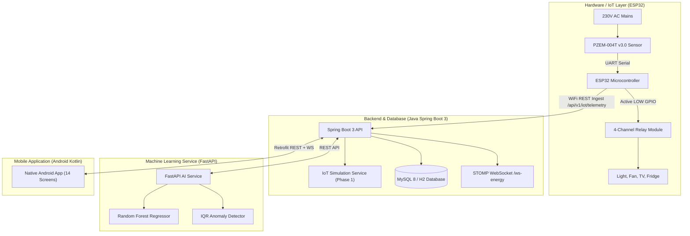

# EnergyEx ⚡
### AI-Powered IoT-Based Smart Electricity Consumption Monitoring and Prediction System

An end-to-end full-stack engineering solution for intelligent domestic electricity monitoring, anomaly detection, appliance relay automation, and machine learning load forecasting.

---

## 🏗️ Architecture Overview



---

## 🚀 Quick Startup Guide

### ⚡ One-Click Master Launcher
Double-click [`start_all_services.bat`](start_all_services.bat) in the project root:
* Starts the Python AI microservice on `http://localhost:8000/`.
* Starts the Spring Boot 3 enterprise backend on `http://localhost:8080/`.
* Automatically launches the **Live Web Dashboard** in your default browser at `http://localhost:8080/`.

---

### 1. Spring Boot Backend (Java 21)
The backend includes an automatic H2 fallback (MySQL mode) for instant zero-config startup, and supports MySQL 8.0 via `--spring.profiles.active=mysql`.
Serves the live interactive Web Dashboard at `http://localhost:8080/`.

```bash
cd backend
# Starts backend on http://localhost:8080 with IoT Simulator & REST/WebSocket
.\mvnw.bat spring-boot:run
```

*To connect to MySQL 8 instead of H2:*
```bash
.\mvnw.bat spring-boot:run "-Dspring-boot.run.profiles=mysql"
```

---

### 2. Python FastAPI AI Service (Machine Learning)
Handles 7-day and 30-day Random Forest load forecasting and statistical anomaly spike detection.

```bash
cd ai-service
# Run with Python
python run_ai_service.py
# Or with uvicorn directly
uvicorn app.main:app --host 0.0.0.0 --port 8000
```
Interactive Swagger API docs available at: `http://localhost:8000/docs`

---

### 3. Postman API Collection
Import [`docs/EnergyEx_Postman_Collection.json`](docs/EnergyEx_Postman_Collection.json) into Postman to test all 18 endpoints (Telemetry ingestion, relay toggling, tariff billing, and AI predictions).

---

### 3. Android Mobile Application (Kotlin)
Open the `android/` directory in **Android Studio**.

- Build and run on an Android Emulator or physical phone.
- **Server URL:**
  - On Emulator: Default `http://10.0.2.2:8080/` connects directly to your laptop's Spring Boot backend.
  - On Physical Phone: In the first-time setup or Settings screen, set the URL to your laptop's Wi-Fi IP (e.g. `http://192.168.1.150:8080/`).

---

### 4. Phase 1 vs Phase 2 Mode Switching

| Mode | Data Source | Hardware Required? | Label Displayed |
| :--- | :--- | :--- | :--- |
| **DEMO MODE (Phase 1)** | Built-in realistic IoT simulator (cyclic fridge compressor, fan inductive PF, light, TV) | **No** | `DEMO DATA (SIMULATION ACTIVE)` |
| **LIVE IoT MODE (Phase 2)** | Real ESP32 + PZEM-004T v3.0 telemetry over Wi-Fi | **Yes** (arriving tomorrow) | `LIVE IoT SENSOR DATA (PZEM-004T)` |

Switch between modes at any time by tapping the **Mode Badge** in the app header or via the IoT Setup screen. No code rebuild or data reset is required!

---

## 📱 14 Implemented Screens
1. **Splash Screen**: Animated branding and initialization.
2. **First-Time User Setup**: User name, electricity tariff (₹/kWh), backend URL, and onboarding tutorial.
3. **Home Dashboard**: Total kWh, ₹ estimated bill, connected appliances count, live watts, today's energy, real-time waveform chart, AI forecast summary, and mode switcher.
4. **Appliance List**: Individual monitoring cards for Light, Fan, TV, and Refrigerator with live power, cumulative kWh, and estimated cost.
5. **Individual Appliance Details**: Detailed diagnostic inspection and telemetry for specific channels.
6. **Live Electricity Monitoring**: Digital gauge cards for Voltage (V), Current (A), Active Power (W), Energy (kWh), Frequency (Hz), and Power Factor (PF).
7. **Consumption History**: Daily (24h), Weekly (7d), and Monthly (30d) energy and cost reports with trend graphs.
8. **Electricity Bill Estimation**: Indian Rupees (₹) slab-wise tariff calculator (0-100 kWh, 101-300 kWh, >300 kWh + fixed charge) and projected end-of-month bill.
9. **AI Prediction**: 7-day forecast curve using Random Forest Regressor, confidence evaluation score, anomaly detection, and actionable energy-saving tips.
10. **Alerts & Notifications**: High-power spikes, grid voltage warnings, and automated schedule execution logs.
11. **Remote Appliance Control**: Tactile relay switching with command acknowledgment states (`PENDING` -> `EXECUTED` -> `CONFIRMED`).
12. **Scheduling**: Automated ON/OFF timer manager with daily/weekly repeat rules.
13. **Wi-Fi & IoT Device Setup**: ESP32 pairing, IP address monitor, token authentication, and live hardware health indicators.
14. **Settings & Profile**: User profile, tariff editor, server endpoint configuration, and system information.

---

## 🔌 Hardware Assembly (For Tomorrow's Hardware Arrival)
Refer to [`firmware/HARDWARE_WIRING_GUIDE.md`](firmware/HARDWARE_WIRING_GUIDE.md) for full circuit schematics, pinout tables, and mains AC safety guidelines.

